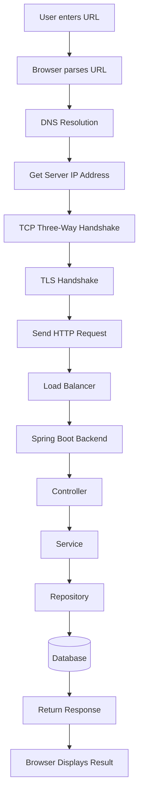
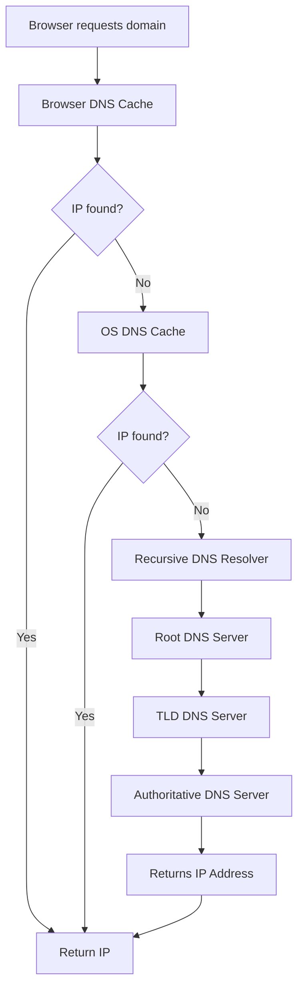
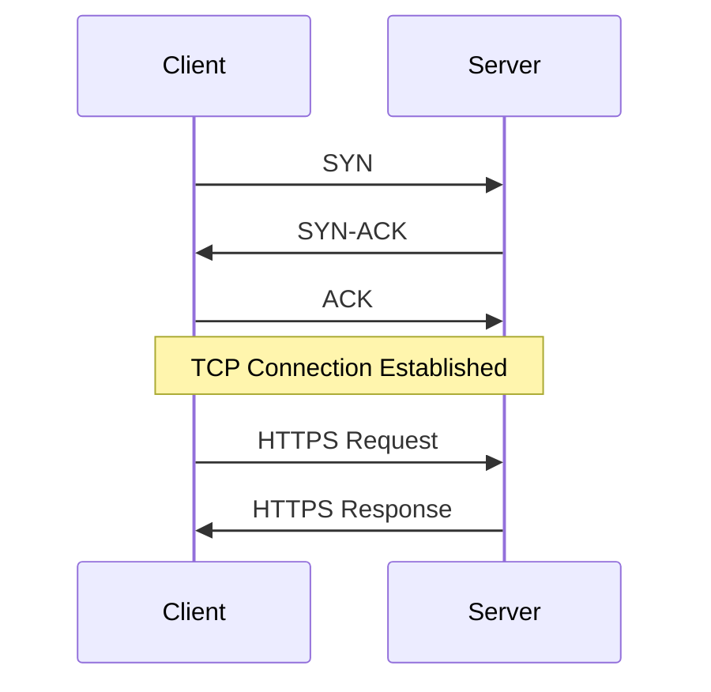

# Networking Fundamentals – Backend Developer Interview Preparation

**Level:** Beginner to Intermediate
**Experience Target:** 2.3 Years
**Topics:** URL, DNS, TCP, TLS, HTTP/HTTPS, Browser-to-Server Communication

---

# Table of Contents

1. [Introduction](#1-introduction)
2. [What is a URL?](#2-what-is-a-url)
3. [Components of a URL](#3-components-of-a-url)
4. [HTTP vs HTTPS](#4-http-vs-https)
5. [Domain Name vs IP Address](#5-domain-name-vs-ip-address)
6. [What Happens When You Enter a URL in Chrome?](#6-what-happens-when-you-enter-a-url-in-chrome)
7. [Browser DNS Caching](#7-browser-dns-caching)
8. [Operating System DNS Caching](#8-operating-system-dns-caching)
9. [What is DNS?](#9-what-is-dns)
10. [How DNS Resolution Works](#10-how-dns-resolution-works)
11. [Four Important DNS Components](#11-four-important-dns-components)
12. [TCP – Transmission Control Protocol](#12-tcp--transmission-control-protocol)
13. [TCP Three-Way Handshake](#13-tcp-three-way-handshake)
14. [What Happens If the Server Does Not Respond?](#14-what-happens-if-the-server-does-not-respond)
15. [TLS Handshake](#15-tls-handshake)
16. [HTTP Request and Response](#16-http-request-and-response)
17. [Browser Rendering](#17-browser-rendering)
18. [Practical Windows Commands](#18-practical-windows-commands)
19. [Backend Developer Interview Questions and Answers](#19-backend-developer-interview-questions-and-answers)
20. [Scenario-Based Interview Questions](#20-scenario-based-interview-questions)
21. [Quick Revision](#21-quick-revision)

---

# 1. Introduction

Whenever we enter a website URL in a browser, several networking processes happen behind the scenes.

For example:

`https://www.google.com`

The browser needs to:

1. Understand the URL.
2. Find the IP address associated with the domain.
3. Establish a connection with the server.
4. Secure the connection using TLS.
5. Send an HTTP request.
6. Receive an HTTP response.
7. Render the webpage.

Understanding this complete flow is important for backend developers because backend applications communicate with clients, APIs, databases, and other services over networks.


# Networking Fundamentals

## 1. Client-to-Server Request Flow



## 2. DNS Resolution



## 3. TCP Three-Way Handshake




# 2. What is a URL?

URL stands for **Uniform Resource Locator**.

A URL is an address used to locate and access a particular resource on the internet.

Example:

`https://www.example.com/products`

Here, the URL tells the browser how to communicate and which resource to request.

# 3. Components of a URL

Consider the following URL:

`https://www.example.com:443/products?id=101#details`

| Component       | Value                                     | Description                                   |
| --------------- | ----------------------------------------- | --------------------------------------------- |
| Scheme          | https                                     | Defines the communication protocol            |
| Domain          | [www.example.com](http://www.example.com) | Identifies the hostname                       |
| Port            | 443                                       | Identifies the destination service port       |
| Path            | /products                                 | Identifies the requested resource or endpoint |
| Query Parameter | id=101                                    | Sends additional information                  |
| Fragment        | #details                                  | Identifies a section within the resource      |

### Important components

**1. Scheme**

Specifies the communication protocol.

Examples:

- HTTP
- HTTPS

**2. Domain Name**

The human-readable address of a website.

Example: `www.google.com`

**3. Path**

Identifies the resource or endpoint requested from the server.

Example: `/products`

**4. Query Parameters**

Pass additional information to the server.

Example: `?id=101`

**5. Port**

Identifies the destination application or service.

Common ports:

- HTTP: 80
- HTTPS: 443
- MySQL: 3306
- SSH: 22

**6. Fragment**

Identifies a particular section of a resource. It is generally processed by the browser and is not sent as part of the HTTP request to the server.

### Interview Answer

A URL stands for Uniform Resource Locator. Its main components include the scheme, domain name, and path. It can also contain a port, query parameters, and a fragment. The scheme specifies the protocol, the domain identifies the destination hostname, and the path identifies the requested resource.

# 4. HTTP vs HTTPS

HTTP stands for **Hypertext Transfer Protocol**.

HTTPS stands for **Hypertext Transfer Protocol Secure**.

HTTP is used for communication between clients and servers. HTTPS protects HTTP communication using TLS encryption.

| HTTP                                             | HTTPS                                            |
| ------------------------------------------------ | ------------------------------------------------ |
| Not encrypted by TLS                             | Protected using TLS                              |
| Data can be intercepted and read more easily     | Traffic contents are encrypted                   |
| Default port 80                                  | Default port 443                                 |
| Does not provide TLS-based server authentication | Uses TLS certificates to authenticate the server |
| Less secure                                      | More secure                                      |

### What is encryption?

Encryption converts readable information into an encoded form so unauthorized parties cannot easily understand it.

Example:

When a user submits login credentials through HTTPS, TLS protects the communication between the browser and server.

### Why do we need HTTPS?

1. Protects sensitive information.
2. Provides confidentiality.
3. Helps detect tampering with data.
4. Authenticates the server through certificates.

### Interview Answer

HTTP is a communication protocol used to transfer data between clients and servers. HTTPS is the secure version of HTTP, which uses TLS to encrypt communication, authenticate the server, and protect data from unauthorized access or modification.

# 5. Domain Name vs IP Address

### What is a domain name?

A domain name is a human-readable address used to access websites.

Example:

`www.google.com`

### What is an IP address?

IP stands for Internet Protocol.

An IP address is a numerical address used to identify a network interface and route traffic to the appropriate destination.

Example:

`142.250.183.14`

### Difference

| Domain Name         | IP Address                     |
| ------------------- | ------------------------------ |
| Human-readable      | Numerical address              |
| Easy to remember    | Difficult to remember          |
| Resolved using DNS  | Used for network communication |
| Example: google.com | Example: 142.250.183.14        |

**Important:** Domain names must be unique within the DNS naming system. Multiple domain names can resolve to the same IP address. IP addresses can also be reused in different private networks.

### Interview Answer

A domain name is a human-readable website address, whereas an IP address is a numerical network address used to identify a destination. DNS translates domain names into IP addresses so that computers can communicate with the correct destination.

# 6. What Happens When You Enter a URL in Chrome?

This is one of the most important networking interview questions.

Suppose we enter:

`https://www.google.com`

The following processes happen.

### Step 1: Browser DNS Cache

The browser checks whether it already has the IP address associated with the requested domain name.

If available and valid, it can use the cached result.

If unavailable, the next DNS resolution steps are performed.

### Step 2: Operating System DNS Cache

The operating system checks its DNS cache.

For example, Windows may already have the IP address stored from an earlier website visit.

If available and valid, the operating system can use it.

Otherwise, it contacts the configured DNS resolver.

### Step 3: DNS Resolution

The recursive DNS resolver finds the IP address associated with the domain.

It may use its own cache or query other DNS servers.

### Step 4: TCP Three-Way Handshake

The browser establishes a TCP connection with the destination server.

The process contains three messages:

1. SYN
2. SYN-ACK
3. ACK

### Step 5: TLS Handshake

For HTTPS over TCP, the browser and server perform a TLS handshake.

They authenticate the server, negotiate security settings, and establish encryption keys.

### Step 6: HTTP Request

The browser sends an HTTP request to the server.

Example:

`GET / HTTP/1.1`

### Step 7: HTTP Response

The server processes the request and returns an HTTP response.

Example:

`HTTP/1.1 200 OK`

### Step 8: Browser Rendering

Chrome processes HTML, CSS, JavaScript, images, and other resources to display the webpage.

### Complete Flow

```text
User enters URL in Chrome
          |
          v
   Browser DNS Cache
          |
          v
   OS DNS Cache
          |
          v
 Recursive DNS Resolver
          |
          v
     IP Address
          |
          v
 TCP Three-Way Handshake
          |
          v
      TLS Handshake
          |
          v
     HTTP Request
          |
          v
    Server Processing
          |
          v
     HTTP Response
          |
          v
   Browser Rendering
          |
          v
    Webpage Displayed
```

**Note:** This is a typical HTTPS-over-TCP flow. HTTP/3 uses QUIC instead of TCP.

# 7. Browser DNS Caching

Browser DNS caching is the process of temporarily storing domain names and their corresponding IP addresses inside the browser.

### Example

Suppose we access:

`www.google.com`

Chrome resolves the domain and may cache the corresponding IP address.

When we access the same domain again, Chrome can use the cached result if it is still valid.

### Advantages

1. Reduces repeated DNS lookups.
2. Improves website loading performance.
3. Reduces unnecessary DNS resolution requests.

### Interview Answer

Browser DNS caching is the process of temporarily storing domain names and their corresponding IP addresses in the browser. When a user visits a website, the browser first checks its DNS cache. If the IP address is available and valid, it uses that address. Otherwise, it proceeds with further DNS resolution.

# 8. Operating System DNS Caching

Operating system DNS caching is the process of temporarily storing domain names and their corresponding IP addresses at the operating system level.

For example, Windows maintains a DNS resolver cache.

### How does it work?

1. User enters a website URL.
2. Browser checks its DNS cache.
3. If unavailable, the operating system's resolver checks its cache.
4. If the IP address is available and valid, it uses it.
5. Otherwise, it contacts the configured DNS resolver.

### Browser DNS Cache vs OS DNS Cache

| Browser DNS Cache            | OS DNS Cache                      |
| ---------------------------- | --------------------------------- |
| Maintained by browser        | Maintained by operating system    |
| Used by that browser         | Can benefit multiple applications |
| Stores domain-to-IP mappings | Stores domain-to-IP mappings      |

Both caches store domain-to-IP mappings. They differ mainly in where they are maintained and which applications can benefit.

### Interview Answer

Operating system DNS caching is the process of temporarily storing domain names and their corresponding IP addresses at the operating system level. It reduces repeated DNS lookups and improves network performance.

# 9. What is DNS?

DNS stands for **Domain Name System**.

DNS translates human-readable domain names into IP addresses.

Example:

```text
Domain Name: www.google.com
IP Address: Corresponding Google server IP
```

### Why do we need DNS?

Computers use IP addresses to communicate over networks, but humans find domain names easier to remember.

DNS connects these two.

Without DNS, users would need to remember IP addresses to access websites.

### Interview Answer

DNS is a naming system that translates human-readable domain names into IP addresses. It allows clients to locate servers without remembering numerical IP addresses.

# 10. How DNS Resolution Works

Suppose a user enters:

`www.example.com`

Assume the recursive resolver does not already have the answer cached.

The DNS resolution process is:

1. The client requests the IP address from its configured recursive DNS resolver.
2. The recursive resolver queries a root DNS server.
3. The root DNS server refers it to the appropriate TLD server.
4. The recursive resolver queries the TLD DNS server.
5. The TLD server refers it to the authoritative DNS server.
6. The recursive resolver queries the authoritative DNS server.
7. The authoritative server provides the requested DNS record.
8. The recursive resolver returns the result to the client.

# 11. Four Important DNS Components

## 11.1 Recursive DNS Resolver

A recursive DNS resolver receives DNS queries from clients and finds the requested DNS information on their behalf.

It may:

- Return the answer from its cache.
- Query root DNS servers.
- Query TLD DNS servers.
- Query authoritative DNS servers.

Examples of public DNS resolvers:

- Google DNS: 8.8.8.8
- Cloudflare DNS: 1.1.1.1

## 11.2 Root DNS Server

Root DNS servers are at the top of the DNS hierarchy.

They direct recursive resolvers towards the appropriate Top-Level Domain servers.

For example, for `www.example.com`, the root server points the resolver towards the `.com` TLD servers.

## 11.3 TLD DNS Server

TLD stands for Top-Level Domain.

Examples:

- .com
- .org
- .in
- .net

A TLD DNS server directs the resolver towards the authoritative DNS servers responsible for a domain.

## 11.4 Authoritative DNS Server

An authoritative DNS server stores the DNS records for a domain.

It provides the requested DNS information.

Common DNS record types:

| Record | Purpose                                                                        |
| ------ | ------------------------------------------------------------------------------ |
| A      | Maps a hostname to an IPv4 address                                             |
| AAAA   | Maps a hostname to an IPv6 address                                             |
| CNAME  | Creates an alias for another hostname                                          |
| MX     | Identifies mail servers                                                        |
| NS     | Identifies authoritative name servers                                          |
| TXT    | Stores text information, often used for domain verification and email security |

### DNS Resolution Diagram

```text
       Client / Computer
              |
              v
    Recursive DNS Resolver
              |
              v
        Root DNS Server
              |
              v
         TLD DNS Server
              |
              v
    Authoritative DNS Server
              |
              v
        DNS Record / IP
              |
              v
    Recursive DNS Resolver
              |
              v
         Client / Computer
```

### Interview Answer

DNS resolution starts when the client requests an IP address from a recursive DNS resolver. If the resolver does not have the answer cached, it queries the root DNS server, which directs it to the appropriate TLD server. The TLD server points it towards the authoritative DNS server, which provides the requested DNS record. The recursive resolver then returns the answer to the client.

# 12. TCP – Transmission Control Protocol

TCP stands for **Transmission Control Protocol**.

TCP is a connection-oriented transport-layer protocol.

It provides reliable communication between two endpoints.

### Features of TCP

1. Connection-oriented communication.
2. Reliable data delivery.
3. Error detection.
4. Retransmission of lost data.
5. Data ordering.
6. Flow control.
7. Congestion control.

### Why do we need TCP?

Imagine sending important information from a client to a server.

We need to make sure:

- Data reaches the destination.
- Data arrives in the correct order.
- Lost data can be retransmitted.

TCP helps provide these guarantees.

### TCP vs UDP

| TCP                                     | UDP                                                          |
| --------------------------------------- | ------------------------------------------------------------ |
| Connection-oriented                     | Connectionless                                               |
| Reliable delivery                       | No delivery guarantee                                        |
| Maintains ordering                      | No ordering guarantee                                        |
| Uses acknowledgements                   | No TCP-style acknowledgements                                |
| More protocol overhead                  | Less protocol overhead                                       |
| Examples: HTTPS over HTTP/1.1 or HTTP/2 | Examples: DNS queries, streaming and real-time communication |

# 13. TCP Three-Way Handshake

The TCP three-way handshake establishes a connection between a client and server.

It consists of three steps.

## Step 1: SYN

SYN stands for Synchronize.

The client sends a SYN packet to the server to request a TCP connection.

## Step 2: SYN-ACK

SYN-ACK means Synchronize-Acknowledgement.

The server acknowledges the client's SYN and sends its own SYN to establish communication in the opposite direction.

## Step 3: ACK

ACK stands for Acknowledgement.

The client acknowledges the server's SYN-ACK.

The TCP connection is now established.

### Diagram

```text
       CLIENT                         SERVER
          |                              |
          | -------- SYN ------------->  |
          |                              |
          | <------ SYN-ACK -----------  |
          |                              |
          | -------- ACK ------------->  |
          |                              |
          |                              |
          |     CONNECTION ESTABLISHED   |
```

### Simple Real-Life Example

Imagine making a phone call.

1. Client: Hello, can you hear me?
2. Server: Yes, I can hear you. Can you hear me?
3. Client: Yes, I can hear you.

Now both parties can communicate.

### Interview Answer

The TCP three-way handshake is the process of establishing a reliable TCP connection between a client and server. First, the client sends SYN. The server responds with SYN-ACK. Finally, the client sends ACK. After these three steps, the TCP connection is established.

# 14. What Happens If the Server Does Not Respond?

There are different possible scenarios.

## Scenario 1: Server Does Not Respond

The client sends SYN, but the server does not respond.

Possible reasons:

- Server is down.
- Network connectivity issue.
- Firewall silently drops packets.
- Server is unreachable.

The client may retransmit the SYN packet according to its TCP timeout and retry policy.

Eventually, the connection attempt times out.

A browser may show:

`ERR_CONNECTION_TIMED_OUT`

## Scenario 2: Server Sends TCP RST

RST stands for Reset.

If the destination is reachable but the requested port is closed, the server may respond with a TCP RST packet.

The connection is actively rejected.

A browser may show:

`ERR_CONNECTION_REFUSED`

## Difference Between Connection Refused and Timed Out

| Connection Refused            | Connection Timed Out                               |
| ----------------------------- | -------------------------------------------------- |
| Connection actively rejected  | No successful response within timeout              |
| Often caused by a closed port | Often caused by network issues or packet filtering |
| May receive TCP RST           | May receive no response                            |

### Interview Answer

If a server does not respond to a client's SYN packet, the client may retransmit the request and wait for a response. If the connection cannot be established within the timeout period, the connection attempt fails. If the destination actively rejects the connection, it may send a TCP RST packet, resulting in connection refused.

# 15. TLS Handshake

TLS stands for **Transport Layer Security**.

TLS provides secure communication between clients and servers.

HTTPS uses TLS to protect HTTP communication.

### Why do we need TLS?

TLS provides:

1. Confidentiality through encryption.
2. Authentication through digital certificates.
3. Integrity through cryptographic protection.

### Simplified TLS Handshake

For a typical TLS 1.3 handshake:

**Step 1: ClientHello**

The client sends supported TLS versions, cipher suites, and key-exchange information.

**Step 2: ServerHello**

The server selects the security parameters and responds with its key-exchange information.

**Step 3: Server Authentication**

The server provides its certificate and proves possession of the corresponding private key.

The client validates the certificate.

**Step 4: Session Keys**

Both sides derive shared encryption keys.

**Step 5: Secure Communication**

The client and server exchange encrypted application data.

### TCP Handshake vs TLS Handshake

| TCP Handshake                        | TLS Handshake                          |
| ------------------------------------ | -------------------------------------- |
| Establishes TCP connection           | Establishes secure communication       |
| Uses SYN, SYN-ACK, ACK               | Uses TLS handshake messages            |
| Provides reliable transport          | Provides encryption and authentication |
| Happens before TLS in HTTPS over TCP | Happens after TCP connection           |

**Important:** TLS 1.3 can complete its normal handshake in one round trip. The details differ in older TLS versions.

# 16. HTTP Request and Response

HTTP stands for Hypertext Transfer Protocol.

It follows a request-response communication model.

The client sends a request, and the server returns a response.

## HTTP Request

An HTTP request contains:

1. Request method.
2. URL path.
3. Headers.
4. Optional request body.

Example:

```http
GET /products/101 HTTP/1.1
Host: example.com
Accept: application/json
```

### Common HTTP Methods

| Method | Purpose                     |
| ------ | --------------------------- |
| GET    | Retrieve data               |
| POST   | Create or submit data       |
| PUT    | Replace a resource          |
| PATCH  | Partially update a resource |
| DELETE | Delete a resource           |

## HTTP Response

An HTTP response contains:

1. Status code.
2. Response headers.
3. Optional response body.

Example:

```http
HTTP/1.1 200 OK
Content-Type: application/json

{
  "id": 101,
  "name": "Laptop"
}
```

### Common HTTP Status Codes

| Status Code | Meaning                |
| ----------- | ---------------------- |
| 200         | OK                     |
| 201         | Created                |
| 204         | No Content             |
| 400         | Bad Request            |
| 401         | Unauthorized           |
| 403         | Forbidden              |
| 404         | Not Found              |
| 405         | Method Not Allowed     |
| 409         | Conflict               |
| 415         | Unsupported Media Type |
| 429         | Too Many Requests      |
| 500         | Internal Server Error  |
| 502         | Bad Gateway            |
| 503         | Service Unavailable    |
| 504         | Gateway Timeout        |

### Interview Answer

HTTP follows a request-response model. The client sends an HTTP request containing a method, path, headers, and optionally a body. The server processes the request and returns an HTTP response containing a status code, headers, and optionally a response body.

# 17. Browser Rendering

After receiving the HTTP response, the browser processes the returned resources.

### Main steps

1. Browser receives HTML.
2. Browser parses HTML and builds the DOM.
3. Browser downloads and processes CSS.
4. Browser builds the CSSOM.
5. DOM and CSSOM are used to construct the render tree.
6. Browser performs layout.
7. Browser paints and composites the page.
8. JavaScript executes and may modify the DOM and trigger further rendering.

The browser also downloads additional resources such as images, fonts, CSS, and JavaScript files.

### Interview Answer

Browser rendering is the process of converting HTML, CSS, and JavaScript into a visual webpage. The browser parses HTML to create the DOM, processes CSS to create the CSSOM, builds the render tree, calculates layout, and paints the final page.

# 18. Practical Windows Commands

These commands help troubleshoot DNS and network connectivity.

## 18.1 Display DNS Cache

```cmd
ipconfig /displaydns
```

Displays DNS resolver cache entries maintained by Windows.

## 18.2 Clear DNS Cache

```cmd
ipconfig /flushdns
```

Clears the Windows DNS resolver cache.

## 18.3 Check IP Configuration

```cmd
ipconfig
```

Displays network configuration information.

## 18.4 Detailed Network Configuration

```cmd
ipconfig /all
```

Displays detailed network information, including DNS servers.

## 18.5 Find IP Address of a Domain

```cmd
nslookup google.com
```

Queries DNS to find information about the domain.

## 18.6 Test Network Connectivity

```cmd
ping google.com
```

Tests connectivity using ICMP echo requests, if permitted.

## 18.7 Trace Network Route

```cmd
tracert google.com
```

Shows the route taken by packets towards the destination.

## 18.8 Test a TCP Port

```powershell
Test-NetConnection google.com -Port 443
```

Tests whether a TCP connection to port 443 can be established.

# 19. Backend Developer Interview Questions and Answers

The following questions are useful for backend developer interviews with approximately 2–3 years of experience.

## Basic Networking Questions

### Q1. What happens when you enter a URL in a browser?

**Answer:**

When a user enters a URL in the browser, the browser checks its DNS cache. If the IP address is not available, the operating system checks its DNS cache. If it is also unavailable, the configured recursive DNS resolver resolves the domain name into an IP address.

After DNS resolution, the client establishes a connection with the server. For HTTPS over TCP, the TCP three-way handshake happens first, followed by the TLS handshake. Once the secure connection is established, the browser sends an HTTP request. The server processes it and returns an HTTP response, which the browser renders.

### Q2. What is DNS?

**Answer:**

DNS stands for Domain Name System. It translates human-readable domain names into IP addresses so that clients can communicate with servers.

### Q3. What is the difference between a domain name and an IP address?

**Answer:**

A domain name is a human-readable address, whereas an IP address is a numerical network address used to identify a destination.

### Q4. What is the difference between HTTP and HTTPS?

**Answer:**

HTTP transfers data without TLS encryption. HTTPS uses TLS to provide encrypted and authenticated communication between the client and server.

### Q5. What is a port number?

**Answer:**

A port number identifies a particular application or service on a host.

Examples:

- HTTP: 80
- HTTPS: 443
- MySQL: 3306
- SSH: 22

### Q6. What is the difference between TCP and UDP?

**Answer:**

TCP is connection-oriented and provides reliable, ordered data delivery. UDP is connectionless and does not guarantee delivery or ordering. UDP has lower protocol overhead and is useful for latency-sensitive communication.

### Q7. What is a socket?

**Answer:**

A socket is a communication endpoint used by applications to send and receive data over a network. A TCP connection is commonly identified by the source IP, source port, destination IP, and destination port.

### Q8. What is DNS caching?

**Answer:**

DNS caching temporarily stores domain-to-IP mappings to reduce repeated DNS queries and improve performance.

### Q9. What is a recursive DNS resolver?

**Answer:**

A recursive DNS resolver receives queries from clients and finds the requested DNS information. It may return a cached answer or query other DNS servers.

### Q10. What is the difference between an authoritative DNS server and a recursive resolver?

**Answer:**

A recursive resolver finds DNS information on behalf of clients. An authoritative DNS server provides the DNS records for the domains it manages.

## TCP and TLS Questions

### Q11. What is TCP?

**Answer:**

TCP stands for Transmission Control Protocol. It is a connection-oriented transport-layer protocol that provides reliable and ordered communication between endpoints.

### Q12. Explain the TCP three-way handshake.

**Answer:**

The TCP three-way handshake establishes a connection between a client and server.

1. Client sends SYN.
2. Server responds with SYN-ACK.
3. Client sends ACK.

After this process, the TCP connection is established.

### Q13. What is SYN?

**Answer:**

SYN stands for Synchronize. It is a TCP flag used during connection establishment to initiate communication and synchronize sequence numbers.

### Q14. What is SYN-ACK?

**Answer:**

SYN-ACK is a TCP response from the server that acknowledges the client's SYN and sends the server's own SYN.

### Q15. What is ACK?

**Answer:**

ACK stands for Acknowledgement. It indicates that the receiver has acknowledged the relevant TCP data or sequence information.

### Q16. What happens if the server does not respond to a SYN packet?

**Answer:**

The client may retransmit the SYN packet based on TCP retry and timeout policies. If no response arrives within the timeout period, the connection attempt fails.

### Q17. What is TCP RST?

**Answer:**

RST stands for Reset. It is used to reset or reject a TCP connection. For example, a server may send RST when a client attempts to connect to a closed port.

### Q18. What is the difference between connection refused and connection timed out?

**Answer:**

Connection refused usually means the destination actively rejected the connection, often with a TCP RST. Connection timed out means the client did not receive a successful response within the allowed time.

### Q19. What is TLS?

**Answer:**

TLS stands for Transport Layer Security. It provides encryption, authentication, and integrity protection for network communication.

### Q20. What happens during the TLS handshake?

**Answer:**

During the TLS handshake, the client and server negotiate security parameters, authenticate the server using its certificate, and establish shared encryption keys. After that, application data can be exchanged securely.

### Q21. What is the difference between TCP handshake and TLS handshake?

**Answer:**

The TCP handshake establishes a reliable transport connection. The TLS handshake establishes the security parameters and encryption keys needed for secure communication.

### Q22. What is a TLS certificate?

**Answer:**

A TLS certificate is a digital certificate that binds a domain or identity to a public key. It is issued or signed by a trusted Certificate Authority, allowing clients to authenticate the server.

## HTTP and API Questions

### Q23. What is HTTP?

**Answer:**

HTTP is an application-layer protocol used for communication between clients and servers. It follows a request-response model.

### Q24. What are the common HTTP methods?

**Answer:**

- GET: Retrieve resources.
- POST: Submit data or create resources.
- PUT: Replace a resource.
- PATCH: Partially update a resource.
- DELETE: Delete a resource.

### Q25. What is the difference between GET and POST?

**Answer:**

GET is generally used to retrieve data, while POST is generally used to submit data or create resources. GET requests should be safe and are commonly cacheable. POST requests are generally not cacheable by default.

### Q26. What is the difference between PUT and PATCH?

**Answer:**

PUT generally replaces the target resource with the supplied representation. PATCH applies partial modifications to a resource.

### Q27. What are HTTP status codes?

**Answer:**

HTTP status codes indicate the result of an HTTP request.

- 2xx: Success.
- 3xx: Redirection.
- 4xx: Client errors.
- 5xx: Server errors.

### Q28. What is the difference between 401 and 403?

**Answer:**

401 Unauthorized means valid authentication credentials are required or were not provided. 403 Forbidden means the server understood the request but refuses to authorize it.

### Q29. What is the difference between 404 and 500?

**Answer:**

404 means the requested resource could not be found. 500 indicates an unexpected server-side error.

### Q30. What are HTTP headers?

**Answer:**

HTTP headers provide additional information about the request or response.

Examples:

- Content-Type
- Authorization
- Accept
- Host
- Cache-Control

### Q31. What is JSON?

**Answer:**

JSON stands for JavaScript Object Notation. It is a lightweight data-interchange format commonly used for communication between frontend and backend applications.

### Q32. What is a REST API?

**Answer:**

A REST API is an API designed around REST architectural principles. It commonly exposes resources through URLs and uses HTTP methods such as GET, POST, PUT, PATCH, and DELETE.

### Q33. What is the difference between request headers and request body?

**Answer:**

Request headers contain metadata such as authorization tokens and content types. The request body contains the actual data being sent to the server, such as JSON payloads.

### Q34. What is Content-Type?

**Answer:**

Content-Type specifies the media type of the request or response body.

Example:

`Content-Type: application/json`

### Q35. What is Authorization?

**Answer:**

Authorization is an HTTP request header commonly used to send authentication credentials, such as a Bearer token.

Example:

`Authorization: Bearer <token>`

## Backend and Real-World Scenario Questions

### Q36. Your backend API is not responding. How would you troubleshoot it?

**Answer:**

I would troubleshoot systematically:

1. Check whether the application is running.
2. Verify the API URL and port.
3. Check DNS resolution.
4. Verify network connectivity.
5. Check whether the required port is accessible.
6. Inspect application logs.
7. Check database connectivity.
8. Verify external service dependencies.
9. Check for timeout or configuration issues.

### Q37. Your application works locally but fails in production. What would you check?

**Answer:**

I would compare local and production configurations, including environment variables, database connection details, network permissions, DNS records, firewall rules, application ports, and deployment logs.

### Q38. An API returns 500 Internal Server Error. How would you debug it?

**Answer:**

I would check application logs and exception stack traces, identify the failing service or method, verify database operations, validate input handling, and reproduce the issue in a lower environment if possible.

### Q39. An API returns 404. What could be the reason?

**Answer:**

Possible reasons include an incorrect endpoint URL, an incorrect HTTP method or route mapping, a missing resource, or a gateway routing issue.

### Q40. Your application cannot connect to MySQL. What would you check?

**Answer:**

I would verify:

1. Whether the MySQL server is running.
2. Database hostname and port.
3. Username and password.
4. Database name.
5. Network connectivity.
6. Firewall settings.
7. Database user permissions.
8. JDBC URL and application configuration.

### Q41. What happens when an API request takes too long?

**Answer:**

The client, gateway, or server may hit a timeout. I would inspect application performance, database query execution, external API dependencies, thread usage, network latency, and timeout configuration.

### Q42. What is a connection timeout?

**Answer:**

A connection timeout occurs when a client cannot establish a connection with the destination within the configured time.

### Q43. What is a read timeout?

**Answer:**

A read timeout occurs when a client has established a connection but does not receive the expected response data within the configured time.

### Q44. What is a reverse proxy?

**Answer:**

A reverse proxy receives client requests and forwards them to backend servers. It can provide load balancing, TLS termination, caching, and routing.

Examples include Nginx and HAProxy.

### Q45. What is load balancing?

**Answer:**

Load balancing distributes incoming requests across multiple backend servers to improve availability, scalability, and performance.

### Q46. What is CORS?

**Answer:**

CORS stands for Cross-Origin Resource Sharing. It is a browser security mechanism that controls whether a web page from one origin can access resources from another origin.

### Q47. What is a firewall?

**Answer:**

A firewall monitors and controls incoming and outgoing network traffic based on configured security rules. It can allow or block traffic based on IP addresses, ports, protocols, and other rules.

### Q48. What is the difference between IPv4 and IPv6?

**Answer:**

IPv4 uses 32-bit addresses, while IPv6 uses 128-bit addresses. IPv6 provides a much larger address space.

### Q49. What is latency?

**Answer:**

Latency is the time taken for data to travel from one point to another. High latency can make APIs and applications feel slow.

### Q50. What is the difference between bandwidth and latency?

**Answer:**

Bandwidth represents the maximum data transfer capacity of a network. Latency represents the time taken for data to travel between endpoints.

---

# 20. Scenario-Based Interview Questions

These questions test whether you can apply networking concepts while troubleshooting backend applications.

### Scenario 1: DNS Resolution Failure

**Question:** Your application cannot resolve `api.example.com`. What would you do?

**Answer:**

I would first verify the domain name, then use `nslookup api.example.com` to check DNS resolution. I would inspect the configured DNS resolver, verify DNS records, and check whether the problem is related to the application environment or network configuration.

### Scenario 2: API Works Through IP but Not Domain

**Question:** Your backend API works when accessed through an IP address but fails through its domain name. What could be the issue?

**Answer:**

This could indicate a DNS resolution problem. I would check the domain's DNS records, DNS propagation, configured DNS resolver, and whether the domain points to the correct IP address.

I would also verify TLS certificate configuration if HTTPS is being used.

### Scenario 3: API Returns Connection Refused

**Question:** Your Java application tries to connect to another service but receives connection refused. What could be the reason?

**Answer:**

Possible reasons include:

- Destination service is not running.
- Wrong destination port.
- Application is listening on a different interface.
- Firewall or network policy actively rejects the connection.

I would verify the service status, hostname, port, and network configuration.

### Scenario 4: API Returns Connection Timed Out

**Question:** Your backend service cannot connect to an external API and receives a timeout. What would you investigate?

**Answer:**

I would investigate network connectivity, firewall rules, DNS resolution, destination availability, routing, and configured connection timeouts.

### Scenario 5: API Works in Postman but Not in Browser

**Question:** Your REST API works in Postman but fails in the browser. What could be the reason?

**Answer:**

One possible reason is a CORS configuration issue. Browsers enforce cross-origin security policies, while Postman does not enforce browser CORS restrictions.

I would inspect the browser console and network tab to identify the actual error.

### Scenario 6: HTTPS Certificate Error

**Question:** Your API works with HTTP but fails with HTTPS. What would you check?

**Answer:**

I would verify the TLS certificate, certificate expiration, hostname matching, certificate chain, trusted Certificate Authorities, TLS versions, and server-side TLS configuration.

### Scenario 7: API Is Slow

**Question:** A backend API takes 10 seconds to return a response. How would you investigate?

**Answer:**

I would identify where the time is being spent by checking:

1. Application logs and tracing.
2. Database query execution time.
3. External API calls.
4. Network latency.
5. Thread pool and connection pool usage.
6. CPU and memory utilization.

Then I would optimize the component responsible for the delay.

### Scenario 8: Two Services Cannot Communicate

**Question:** Your Java microservice cannot communicate with another microservice. What would you check?

**Answer:**

I would verify service discovery, DNS resolution, hostnames, ports, network connectivity, firewall rules, authentication, TLS configuration, and service health.

---

# 21. Quick Revision

| Concept            | Key Point                                    |
| ------------------ | -------------------------------------------- |
| URL                | Address used to locate a resource            |
| Scheme             | Communication protocol                       |
| Domain             | Human-readable hostname                      |
| IP Address         | Numerical network address                    |
| DNS                | Resolves domain names into IP addresses      |
| Browser DNS Cache  | Stores DNS results in the browser            |
| OS DNS Cache       | Stores DNS results at OS level               |
| Recursive Resolver | Finds DNS answers for clients                |
| Root DNS           | Directs resolver to TLD servers              |
| TLD DNS            | Directs resolver to authoritative servers    |
| Authoritative DNS  | Provides DNS records                         |
| TCP                | Reliable, connection-oriented protocol       |
| SYN                | Initiates TCP connection                     |
| SYN-ACK            | Acknowledges client SYN and sends server SYN |
| ACK                | Acknowledges server SYN-ACK                  |
| TLS                | Provides secure communication                |
| HTTP               | Request-response protocol                    |
| HTTPS              | HTTP protected by TLS                        |
| GET                | Retrieve data                                |
| POST               | Submit/create data                           |
| 200                | Success                                      |
| 201                | Created                                      |
| 400                | Bad Request                                  |
| 401                | Unauthorized                                 |
| 403                | Forbidden                                    |
| 404                | Not Found                                    |
| 500                | Internal Server Error                        |

---

# 22. Recommended Study Order

Use this checklist to track your preparation.

- [ ] Understand URL and its components.
- [ ] Understand HTTP and HTTPS.
- [ ] Understand domain names and IP addresses.
- [ ] Understand browser DNS caching.
- [ ] Understand operating system DNS caching.
- [ ] Understand DNS resolution.
- [ ] Understand recursive, root, TLD, and authoritative DNS servers.
- [ ] Understand TCP and UDP.
- [ ] Explain the TCP three-way handshake.
- [ ] Understand SYN, SYN-ACK, and ACK.
- [ ] Understand connection refused vs connection timed out.
- [ ] Understand TLS handshake.
- [ ] Understand HTTP request and response.
- [ ] Learn HTTP methods and status codes.
- [ ] Practice Windows networking commands.
- [ ] Practice scenario-based troubleshooting questions.

---

# Final Interview Tip

For a backend developer with 2.3 years of experience, don't just memorize definitions.

Try to connect networking concepts with your Java backend development work.

For example:

- When a Spring Boot API fails, understand how to troubleshoot connection errors.
- When connecting to MySQL, understand hostnames, ports, and connection timeouts.
- When integrating external REST APIs, understand HTTP methods, status codes, headers, and TLS.
- When working with authentication, understand HTTPS, Authorization headers, and JWT.
- When debugging production issues, understand DNS, network connectivity, and application logs.

**The goal is to explain not only what happens but also why it happens and how you would troubleshoot it in a real backend application.**
